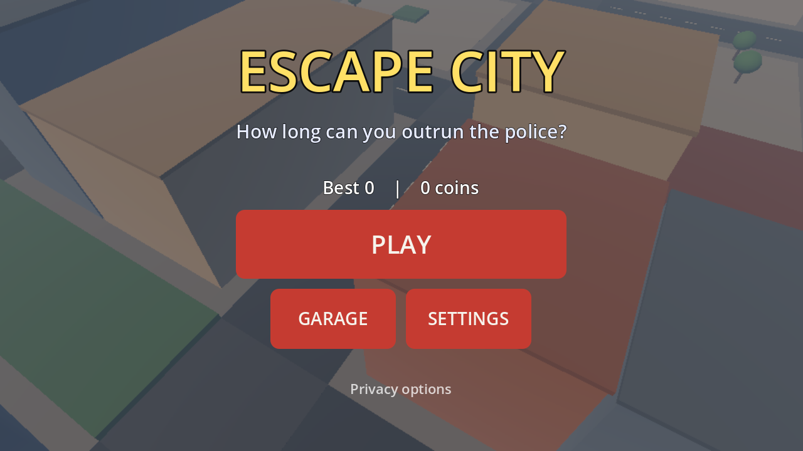
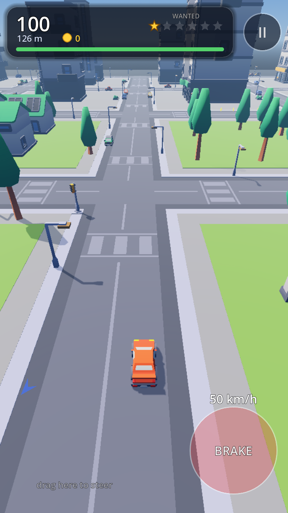
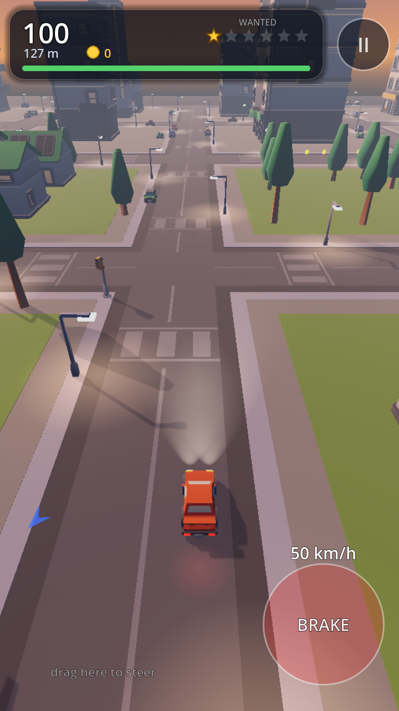
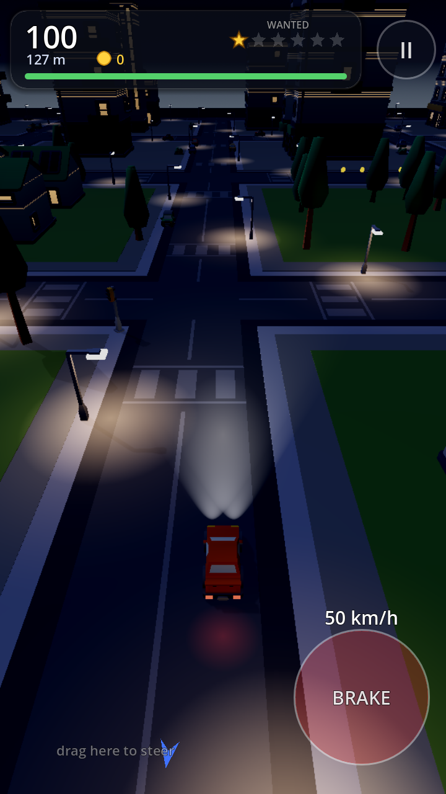
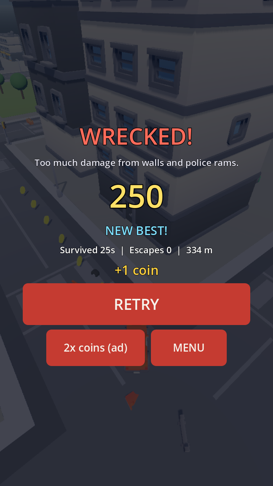

# Escape City

**Endless police pursuit. How long can you outrun the police?**

An arcade car chase, played in **portrait**, through a city built from reusable, certified road blocks. Traffic,
police pressure that ramps up but stays capped, and breakable street props make for
dramatic escapes. Built for Android with **Godot 4.3 (GDScript, GL Compatibility renderer)**,
following the DashPanda *Escape City Development Guide v1.0*.

> Status: **Phase 1 prototype + release scaffolding.** It's playable on desktop with fake
> ad/billing/consent adapters, and verified by an automated play-through and rendered
> screenshots (see [Test harness](#test-harness)). It has not been run on a physical
> Android device yet; see [What still needs a human](#what-still-needs-a-human).

| Menu (night) | Day | Dusk | Night | Results |
|---|---|---|---|---|
|  |  |  |  |  |

Art: [Kenney](https://www.kenney.nl) Car Kit, City Kit (Commercial), City Kit (Roads) and City Kit (Suburban), CC0.

**Time of day** (Settings): a day-night cycle (the default; runs start at dusk), always day, or
always night. At night, building windows glow, there are street lights on both sides of every
road with light pools, the six lamps nearest the car cast real light, cars have headlights and
tail lights (the player's are real spotlights), and police beacons wash the street red and blue.

## Run it

1. Install **Godot 4.3-stable** (standard build, not .NET).
2. Open `project.godot` in the editor (the first import builds `.godot/`), then press **F5**.

Headless automated checks (guide page 11):

```bash
godot --headless --path . --import
```

```bash
godot --headless --path . -s res://tests/run_tests.gd
```

The exit code is 0 when every check passes.

## Test harness

The game reads dev flags passed after `--` (`game/dev/dev_flags.gd`, `game/dev/dev_harness.gd`).
They're kept in the codebase on purpose: they're how the game gets tested without a screen.

| Flag | Effect |
|---|---|
| `--fresh` | Use a throwaway save (deleted at start and end) |
| `--autotest` | Play the whole flow automatically: menu → garage → settings → tutorial → every heat stage → pause/resume → crash → rewarded revive → results → retry → 2× coins → menu → save reload. Prints `[autotest] STAGE stage=N …` lines and exits non-zero on any failed expectation |
| `--until=N` | Stop the autotest once heat stage N is reached |
| `--shot=PATH` | Capture `--screen` to a PNG and quit |
| `--shots=DIR` | Run the autotest and save screenshots at each milestone |
| `--screen=NAME` | `menu`, `garage`, `settings`, `tutorial`, `countdown`, `run`, `pause`, `revive` or `results` |
| `--wait=SEC` | Game seconds to wait before the shot |
| `--near-police` | Wait until a police car is 10–28 m away before the shot |
| `--demo` | Start a run and let the autopilot drive (for video capture) |
| `--probe=SEC` | With `--demo`: log a status line every `--every=SEC` (default 5) and report how often police were within 60 m. Add `--trace` for position, capture progress, HP and each cop's AI state |
| `--seed=N` / `--heat=N` / `--god` | Fixed seed, start at heat stage N, no damage/capture |
| `--closeup` / `--empty` | Low review camera locked behind the direction of travel / hide the city blocks (open asphalt), for judging body roll, tail swing and smoke |
| `--handling=MODE` / `--maneuver` | `drifty` or `grippy`; scripted flick, full-lock and brake-turn at speed, printing slide and drift numbers and failing if the handling contract breaks |
| `--time=MODE` | `day`, `night` or `cycle`; overrides the Time of day setting |
| `--touch` / `--capture-warning` | With `--shot`: inject a real touch drag (shows the steer ring) / show the capture warning |
| `--ad=MODE` | Fake ads: `earn` (default in harness), `dismiss`, `no_fill`, `interactive` |

The autopilot (`game/dev/autopilot.gd`) drives along the lane graph. It picks junction exits
away from police, changes lanes around traffic and brakes into turns.

Fast logic check (no rendering, about 20 s):

```bash
godot --headless --fixed-fps 60 --path . -- --fresh --autotest
```

Real rendering on a virtual screen (Xvfb + Mesa, Compatibility renderer):

```bash
xvfb-run -a -s "-screen 0 720x1280x24" godot --path . --rendering-driver opengl3 --resolution 720x1280 -- --fresh --seed=42 --screen=run --god --wait=12 --shot=/tmp/run.png
```

Video with audio (Movie Maker):

```bash
xvfb-run -a -s "-screen 0 720x1280x24" godot --path . --rendering-driver opengl3 --resolution 720x1280 --write-movie /tmp/clip.avi --fixed-fps 30 --quit-after 780 -- --fresh --seed=4 --heat=3 --god --demo
```

Balance probe (how close is the pursuit, does the run end, and how):

```bash
godot --headless --fixed-fps 60 --path . -- --fresh --demo --probe=120 --seed=3 --heat=5 --ad=no_fill
```

Asset gallery (check orientation/scale of Kenney models; red marker = +X, blue = −Z):

```bash
xvfb-run -a godot --path . --rendering-driver opengl3 -s res://tests/asset_gallery.gd -- --set=roads --out=/tmp/roads.png
```

The README screenshots in `docs/screenshots/` are regenerated this way before commits.

## Controls

| Action | Touch | Keyboard |
|---|---|---|
| Steer | Drag with your left thumb anywhere on the left half (floating stick), **or** the optional left/right buttons (Settings → Controls) | A / D or ← / → |
| Brake | Hold the **BRAKE** pad, bottom right | Space / S / ↓ |
| Drift | Steer hard at speed and the rear steps out; add brake to kick it out further (handbrake). Counter-steer or straighten up to regain grip | steer hard / brake + steer |
| Pause | **II** button, top right | Esc / P |

The car accelerates by itself (auto-throttle). The default **Drifty** handling is deliberately
slippery: the car carries momentum through turns, and once the tyres break loose it keeps
sliding until you straighten up. Settings → Handling → **Grippy** is the easier option. On desktop the mouse acts as a touch, so you
can try drag steering with it.

## How a run plays

* You start with **one pursuer** spawning behind you, out of view.
* **Score** = `survival_seconds × 10 + verified_escapes × 150`.
* **Escape**: no officer has line of sight and all are more than 75 m away for 5 s. There's
  a 20 s cooldown, it pays at most once per disengagement, and it earns you a recovery wave.
* **Busted**: you stay below 4 m/s within 9 m of police for 3 continuous seconds. **Wrecked**:
  your health hits 0 from walls and rams.
* **Heat** rises over time (and a little when you smash props): faster cruising speed, then
  more police and intercept roles, then denser hazards. 40 s pressure waves alternate with
  16 s cool-downs.
* **Coins** come from authored pickup lines plus a capped distance payout (1 per 250 m, max
  40). They're banked once per run and spent in the **Garage** on looks (cosmetic only).
* After a crash you get one optional **rewarded revive** per run, *or* **2× coins** on the
  results screen, never both. Retry always comes before any ad action.

## Project layout

```
addons/dashcore/          shared, versioned package (no game-specific AI)
  core/                   RunSession (state machine), SeedService, ChunkPool
  input/                  InputRouter (drag / buttons / keyboard, UI exclusions)
  save/                   SaveStore (versioned, atomic, backup), Wallet (idempotent credits)
  services/               Ads / Billing / Consent interfaces + fakes, AdPolicy, RewardGate, Telemetry
  audio/ quality/ ui/     bus setup, quality presets, UI builders
  dashcore.gd             autoload: platform/session services only
game/
  scenes/                 main.tscn, AppRoot (bootstrap + screen flow), RunRoot (one run)
  controllers/            PlayerCar, PoliceAgent, TrafficAgent/Manager, PursuitDirector,
                          CaptureResolver, ScoreService, ChaseCamera, BreakableProp, CoinPickup
  generation/             LaneGraph, ChunkPlanner (pure data), ChunkBuilder, StreamingWorld
  data/                   typed resources (.tres): handling, difficulty, chunks, cosmetics
  art/ audio/ ui/         placeholder primitive art, procedural audio, HUD + menus
tests/run_tests.gd        headless acceptance checks
docs/                     design, architecture, build manifest, logs and gate sheets
```

Tune the game feel in `game/data/handling_default.tres` and the pacing in
`game/data/difficulty_default.tres`, and log every change in `docs/TUNING_LOG.md`.

## What still needs a human

* **Physical-device work**: the phase 0 Android smoke build, the device matrix, the
  performance budgets (page 8) and the lifecycle tests on real phones.
* The **10-player prototype gate** (`docs/PLAYTEST_GATE.md`). Don't expand content until it passes.
* **Native adapters**: AdMob + UMP consent + Play Billing through a Godot Android plugin,
  plus server-side purchase verification. The interfaces and fakes are in place.
* **Real art and audio** to replace the primitives and synth, recorded in `docs/ASSET_REGISTER.md`.
* Store listing, privacy policy, Data safety form and content rating (`docs/RELEASE_CHECKLIST.md`).
